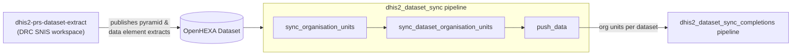

## DHIS2 Dataset Sync Pipeline

### Overview

This pipeline synchronizes organisation units and DATA_ELEMENT data between two DHIS2 instances (source SNIS → target PRS). It aligns the organisation unit pyramid, aligns dataset organisation units, and pushes data element extracts to the target instance.

It consumes pyramid and data element extract files published as an OpenHEXA dataset by the upstream **`dhis2-prs-dataset-extract`** pipeline (DRC SNIS workspace), and only runs when a new version of that dataset is detected (unless forced).

Note: this pipeline does **not** perform data extraction itself, and does **not** sync dataset completion statuses — that is handled by the separate `dhis2_dataset_sync_completions` pipeline, which consumes files produced by the data push step below.

### Data Flow



### Pipeline Parameters

- **run_ou_sync** (default `True`): Runs the organisation units and dataset organisation units sync tasks.
- **run_push_data** (default `True`): Runs the data push task.
- **load_ds_files** (default `True`): Downloads the pyramid/extract files from the OpenHEXA dataset before processing.
- **force_run** (default `False`): Forces the pipeline to run even if no new dataset version is detected.

### Execution Flow

1. **should_push_data**: Checks whether the input OpenHEXA dataset (`OPENHEXA_DATASET_ID`) has a new version since the last run. If not (and `force_run` is `False`), the pipeline exits early.
2. **get_files_from_dataset** *(optional, `load_ds_files`)*: Downloads the pyramid and data element extract files published by `dhis2-prs-dataset-extract`.
3. **sync_organisation_units**: Aligns the organisation unit pyramid onto the target DHIS2 (`DHIS2PyramidAligner`), using the already-filtered pyramid extract (`data/pyramid/snis_prs_pyramid.parquet`).
4. **sync_dataset_organisation_units**: Aligns organisation units of mapped datasets between source and target, using `DATASETS` mappings from `sync_config.json`. Handles special `FULL_PYRAMID` and `ZONES_SANTE` cases.
5. **push_data**: Pushes DATA_ELEMENT extracts to the target DHIS2 using mappings, import strategy and dry-run mode from `push_config.json`. Also writes per-dataset org unit files consumed by the `dhis2_dataset_sync_completions` pipeline.
6. **update_last_run_timestamp**: Records the processed dataset version so the next run can detect changes.

### Push Cache

`push_data` uses a `DHIS2Pusher` (per `EXTRACT_UID`, cached under `cache/<extract_id>/cache_<period>.parquet`) that tracks which datapoints (`dx`, `period`, `org_unit`, `category_option_combo`, `attribute_option_combo`, `value`) have already been pushed. On each run it filters out datapoints whose value is unchanged since the last successful push, so only new or changed values are sent to the target DHIS2. The cache is updated only after a push is confirmed (rejected datapoints are excluded), and is skipped entirely when `DRY_RUN` is `true`.

This caching is separate from the DHIS2 API client's own metadata cache (`connect_to_dhis2(..., cache_dir=...)`), which this pipeline does not use — org unit and data push connections are always created without a client-side cache.

### Configuration

- **extract_config.json**: Only `SETTINGS.SOURCE_DHIS2_CONNECTION` is read (by the dataset organisation units sync step). Other keys (data elements, extraction window, org unit levels) belong to the upstream `dhis2-prs-dataset-extract` pipeline, not this one.
- **push_config.json**: Target connection, import strategy, dry-run mode, max post size, `OPENHEXA_DATASET_ID`, and mappings for data elements.
- **sync_config.json**: `DATASETS` mapping used for dataset organisation units sync. The `ORG_UNITS` section (selection, group UIDs, level limits) is not read by this pipeline — it is consumed by the upstream `dhis2-prs-dataset-extract` pipeline that produces the pre-filtered pyramid.

#### Example Extract Configuration (source connection only is used here)

```json
{
	"SETTINGS": {
		"SOURCE_DHIS2_CONNECTION": "drc-snis"
	}
}
```

#### Example Push Configuration

```json
{
	"SETTINGS": {
		"TARGET_DHIS2_CONNECTION": "drc-prs",
		"IMPORT_STRATEGY": "CREATE_AND_UPDATE",
		"DRY_RUN": false,
		"MAX_POST": 5000,
		"OPENHEXA_DATASET_ID": "..."
	},
	"DATA_ELEMENTS": {
		"EXTRACTS": [
			{
				"EXTRACT_UID": "level_zs",
				"SOURCE_DATASET_UID": "k8mWHTAqHYZ",
				"TARGET_DATASET_UID": "jp5eWxb66XT",
				"MAPPINGS": { ... }
			}
		]
	}
}
```

#### Example Sync Configuration

```json
{
	"DATASETS": {
		"DxDuYrrZSa7": ["wMCnDAQfGZN"],
		"FULL_PYRAMID": ["dbf1uGX1XU3"],
		"ZONES_SANTE": ["Om2WgL4TNEy", "jp5eWxb66XT"]
	}
}
```

### Usage

1. Configure the source/target connections and mappings in the JSON files under `configuration/`.
2. Run the pipeline to align org units, align dataset org units, and push data element extracts.
3. Review logs for each step under the respective `logs/` subdirectory.
